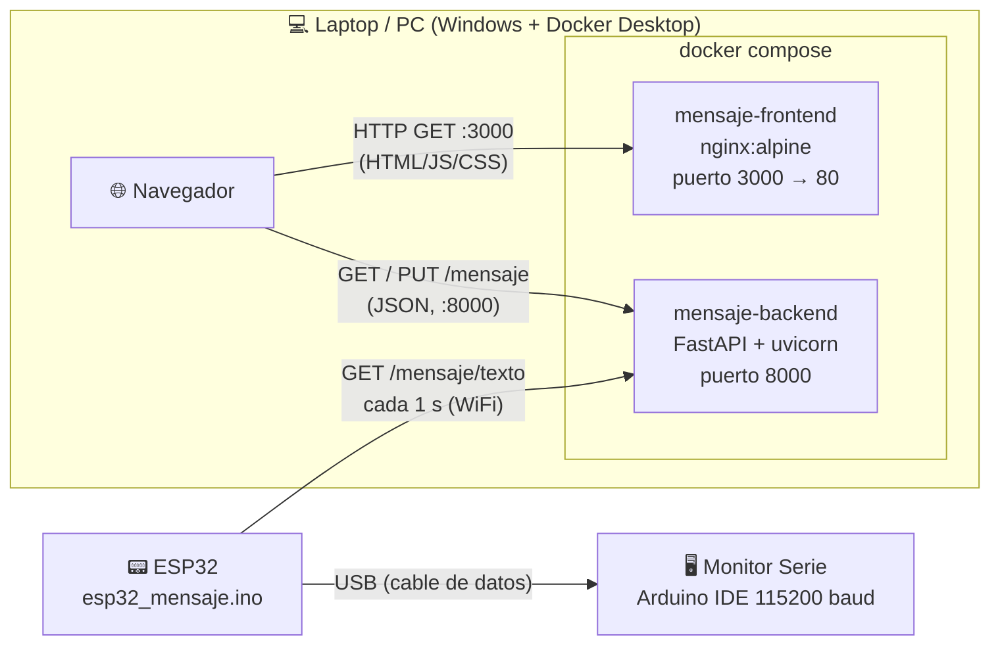
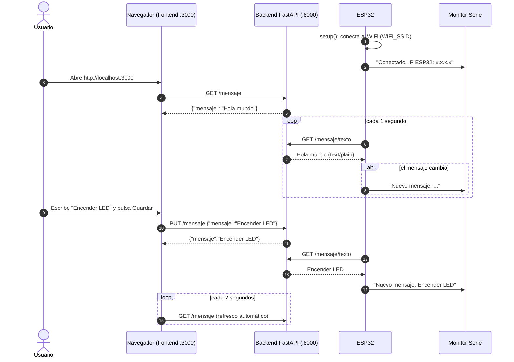
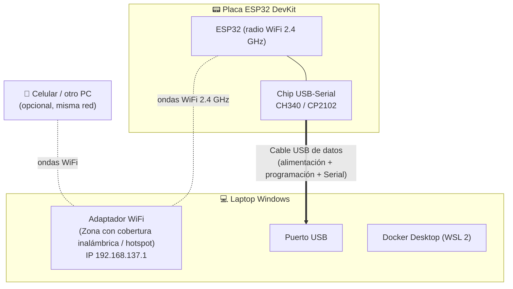
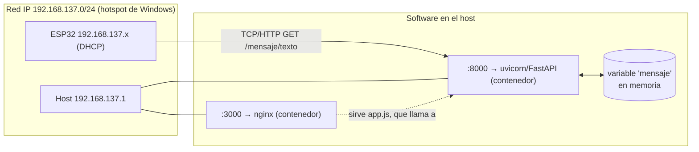
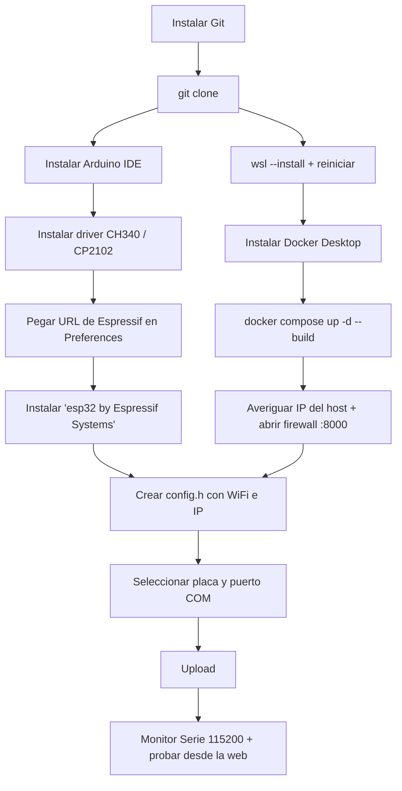

# ESP32 + Web: editor de mensaje

Ejemplo de **Máquinas Digitales (Unillanos 2026-2)**: una página web permite escribir un mensaje, un backend en **FastAPI** lo guarda y una **ESP32** lo consulta por WiFi cada segundo y lo imprime en el Monitor Serie.

```
Navegador ──PUT /mensaje──▶ Backend (FastAPI, Docker) ◀──GET /mensaje/texto── ESP32
```

📘 **Documentación completa (Getting Started, arquitectura, código explicado):** <https://ronytrespalacios.github.io/esp32-mensaje-web/>  
(fuente en [`docs/`](docs/), publicada con GitHub Pages)

---

## Contenido

1. [Estructura del repositorio](#1-estructura-del-repositorio)
2. [Arquitectura](#2-arquitectura)
3. [Proceso (flujo de datos)](#3-proceso-flujo-de-datos)
4. [Diagrama físico vs. lógico](#4-diagrama-físico-vs-lógico)
5. [Puesta en marcha desde cero (Windows recién instalado)](#5-puesta-en-marcha-desde-cero-windows-recién-instalado)
6. [Qué cambiar (WiFi e IP del backend)](#6-qué-cambiar-wifi-e-ip-del-backend)
7. [Uso](#7-uso)
8. [API](#8-api)
9. [Solución de problemas](#9-solución-de-problemas)

---

## 1. Estructura del repositorio

```
.
├── docker-compose.yml          # Levanta backend (8000) y frontend (3000)
├── backend/
│   ├── Dockerfile              # Imagen python:3.12-slim + uvicorn
│   ├── main.py                 # API FastAPI (mensaje en memoria)
│   └── requirements.txt
├── frontend/
│   ├── index.html              # Formulario para editar el mensaje
│   ├── app.js                  # Llama a la API en http://<host>:8000
│   └── styles.css
├── esp32/
│   └── esp32_mensaje/
│       ├── esp32_mensaje.ino   # Sketch de Arduino
│       ├── config.example.h    # Plantilla de configuración (SÍ se sube)
│       └── config.h            # Tu WiFi e IP reales (NO se sube, .gitignore)
└── docs/                       # Sitio de documentación (GitHub Pages)
```

> 🔒 **Las credenciales WiFi nunca se suben al repositorio.** Viven en `esp32/esp32_mensaje/config.h`, que está en `.gitignore`. En el repo solo está la plantilla `config.example.h`.

---

## 2. Arquitectura



| Componente | Tecnología | Puerto | Responsabilidad |
|---|---|---|---|
| Frontend | HTML + JS estático servido por **nginx** | `3000` | Mostrar y editar el mensaje |
| Backend | **FastAPI** (Python 3.12) en Docker | `8000` | Guardar el mensaje en memoria y exponerlo por HTTP |
| ESP32 | Arduino core de Espressif (`WiFi.h`, `HTTPClient.h`) | — | Consultar el mensaje y mostrar cambios por Serial |

> El mensaje se guarda **en memoria**: si reinicias el contenedor del backend vuelve a `"Hola mundo"`.

---

## 3. Proceso (flujo de datos)



---

## 4. Diagrama físico vs. lógico

### Vista física (qué está conectado con qué)



### Vista lógica (cómo se comunican las capas de software)



| | Física | Lógica |
|---|---|---|
| **Enlace PC ↔ ESP32 (programación)** | Cable USB + chip CH340/CP2102 | Puerto `COMx` serie, 115200 baud |
| **Enlace PC ↔ ESP32 (datos)** | Radio WiFi 2.4 GHz | HTTP sobre TCP/IP, `http://BACKEND_HOST:8000/mensaje/texto` |
| **Backend** | El mismo PC | Contenedor Docker publicado en el puerto `8000` |
| **Frontend** | El mismo PC | Contenedor nginx publicado en el puerto `3000` |

---

## 5. Puesta en marcha desde cero (Windows recién instalado)

Todo lo siguiente se hace en un Windows 10/11 sin nada instalado. Los comandos se ejecutan en **PowerShell** (botón Inicio → escribir *PowerShell*). Si `winget` no existe, instala **"Instalador de aplicación"** desde Microsoft Store.

### 5.1 Instalar Git

```powershell
winget install --id Git.Git -e
```

(o descárgalo de <https://git-scm.com/download/win>). **Cierra y vuelve a abrir PowerShell** y comprueba:

```powershell
git --version
```

### 5.2 Clonar el repositorio

```powershell
cd $HOME\Documents
git clone https://github.com/RonyTrespalacios/esp32-mensaje-web.git
cd esp32-mensaje-web
```

### 5.3 Instalar Docker Desktop

Docker Desktop en Windows usa **WSL 2**. En PowerShell **como administrador**:

```powershell
wsl --install
```

Reinicia el equipo. Luego:

```powershell
winget install --id Docker.DockerDesktop -e
```

(o descárgalo de <https://www.docker.com/products/docker-desktop/>). Abre **Docker Desktop**, acepta los términos y espera a que diga *Engine running*. Verifica:

```powershell
docker --version
docker compose version
```

> Si Docker pide habilitar la virtualización, actívala en la BIOS/UEFI (Intel VT-x / AMD-V / SVM).

### 5.4 Levantar backend y frontend

Desde la carpeta del repositorio:

```powershell
docker compose up -d --build
```

Prueba en el navegador:

- Frontend: <http://localhost:3000>
- Backend: <http://localhost:8000/mensaje> → `{"mensaje":"Hola mundo"}`
- Documentación interactiva (Swagger): <http://localhost:8000/docs>

### 5.5 Instalar Arduino IDE

```powershell
winget install --id ArduinoSA.IDE.stable -e
```

(o descárgalo de <https://www.arduino.cc/en/software>).

### 5.6 Instalar el driver USB-Serial de la placa (CH340 / CP2102)

La mayoría de placas ESP32 DevKit baratas usan el chip **CH340** (a veces CH341/CH9102); otras usan **CP2102** de Silicon Labs. Mira el chip pequeño junto al conector USB.

- **CH340 / CH341**: descarga `CH341SER.EXE` de WCH → <https://www.wch-ic.com/downloads/CH341SER_EXE.html>, ejecútalo y pulsa **INSTALL**.
- **CP2102 / CP210x**: <https://www.silabs.com/developers/usb-to-uart-bridge-vcp-drivers> → *CP210x Universal Windows Driver*.

Conecta la ESP32 con un cable USB **de datos** (no solo de carga) y abre **Administrador de dispositivos → Puertos (COM y LPT)**. Debe aparecer algo como `USB-SERIAL CH340 (COM5)`. Anota el número `COMx`.

### 5.7 Agregar las placas ESP32 de Espressif al Arduino IDE

1. Arduino IDE → **File → Preferences** (*Archivo → Preferencias*).
2. En **Additional boards manager URLs** pega:

   ```
   https://espressif.github.io/arduino-esp32/package_esp32_index.json
   ```

3. **OK**.
4. **Tools → Board → Boards Manager…** (o el ícono de placas en la barra izquierda), busca **`esp32`** y instala **"esp32 by Espressif Systems"**. Tarda unos minutos.

> Las librerías `WiFi.h` y `HTTPClient.h` vienen incluidas en ese paquete; no hay que instalar nada más.

### 5.8 Configurar el sketch (WiFi + IP)

1. Ve a `esp32\esp32_mensaje\`.
2. Copia `config.example.h` y renómbralo a **`config.h`**:

   ```powershell
   Copy-Item esp32\esp32_mensaje\config.example.h esp32\esp32_mensaje\config.h
   ```

3. Edita `config.h` según la [sección 6](#6-qué-cambiar-wifi-e-ip-del-backend).

### 5.9 Programar la ESP32

1. Arduino IDE → **File → Open** → `esp32\esp32_mensaje\esp32_mensaje.ino` (verás también la pestaña `config.h`).
2. **Tools → Board → esp32 → ESP32 Dev Module** (o el modelo de tu placa).
3. **Tools → Port → COMx** (el del paso 5.6).
4. Pulsa **Upload** (→). Si se queda en `Connecting.....`, mantén presionado el botón **BOOT** de la placa hasta que empiece a escribir.
5. Abre **Tools → Serial Monitor** a **115200 baud**. Deberías ver:

   ```
   Conectando a WiFi.....
   Conectado. IP ESP32: 192.168.137.23
   Consultando: http://192.168.137.1:8000/mensaje/texto
   Nuevo mensaje: Hola mundo
   ```

### 5.10 Resumen del orden



---

## 6. Qué cambiar (WiFi e IP del backend)

Todo lo configurable de la ESP32 está en **`esp32/esp32_mensaje/config.h`** (tu copia local de `config.example.h`):

```cpp
#define WIFI_SSID     "NOMBRE_DE_TU_RED"   // red WiFi 2.4 GHz
#define WIFI_PASSWORD "CLAVE_DE_TU_RED"
#define BACKEND_HOST  "192.168.137.1"      // IP del PC con Docker
#define BACKEND_PORT  8000
```

### 6.1 Red WiFi

La ESP32 **solo funciona en 2.4 GHz**. Opciones:

- **Hotspot de Windows (recomendado en clase)**: *Configuración → Red e Internet → Zona con cobertura inalámbrica móvil*. Define nombre y contraseña, y en *Banda* elige **2.4 GHz**. Con esto la IP del PC es casi siempre **`192.168.137.1`**.
- **Router de casa / laboratorio**: usa su SSID y clave; el PC con Docker debe estar conectado a la **misma red**.

### 6.2 IP del host del backend (`BACKEND_HOST`)

Es la IP del PC donde corre Docker **en la red a la que se conecta la ESP32**. Para verla:

```powershell
ipconfig
```

Busca el adaptador correcto:

- Con hotspot de Windows: *"Adaptador de LAN inalámbrica Conexión de área local\* N"* → `192.168.137.1`.
- Con router: *"Adaptador de LAN inalámbrica Wi-Fi"* → p. ej. `192.168.1.50`.

> ⚠️ No uses `localhost` ni `127.0.0.1` en la ESP32: eso apunta a la propia ESP32, no al PC.

### 6.3 Firewall de Windows (puerto 8000)

Para que la ESP32 (u otro dispositivo) llegue al backend, permite el puerto 8000 entrante. PowerShell **como administrador**:

```powershell
New-NetFirewallRule -DisplayName "Backend ESP32 8000" -Direction Inbound -Protocol TCP -LocalPort 8000 -Action Allow -Profile Private,Public
New-NetFirewallRule -DisplayName "Frontend 3000" -Direction Inbound -Protocol TCP -LocalPort 3000 -Action Allow -Profile Private,Public
```

Prueba desde el celular conectado a la misma red: `http://<BACKEND_HOST>:8000/mensaje`.

### 6.4 Otros puntos opcionales

| Qué | Dónde |
|---|---|
| Puertos publicados | `docker-compose.yml` (`"8000:8000"`, `"3000:80"`). Si cambias el 8000, cámbialo también en `config.h` y en `frontend/app.js` |
| Frecuencia de consulta de la ESP32 | `delay(1000)` al final de `loop()` en el `.ino` |
| Frecuencia de refresco de la web | `setInterval(cargarMensaje, 2000)` en `frontend/app.js` |
| Mensaje inicial | `mensaje: str = "Hola mundo"` en `backend/main.py` |

El frontend **no** necesita cambios: usa automáticamente `http://<host con el que abriste la página>:8000`.

---

## 7. Uso

```powershell
docker compose up -d --build   # levantar (o reconstruir tras cambiar código)
docker compose ps              # ver estado
docker compose logs -f backend # ver logs del backend
docker compose down            # apagar
```

1. Abre <http://localhost:3000> (o `http://<IP-del-PC>:3000` desde el celular).
2. Escribe un mensaje y pulsa **Guardar**.
3. En el Monitor Serie de la ESP32 aparece `Nuevo mensaje: ...` en ~1 segundo.

También puedes cambiarlo sin la web:

```powershell
Invoke-RestMethod -Method Put -Uri http://localhost:8000/mensaje -ContentType "application/json" -Body '{"mensaje":"Hola desde PowerShell"}'
```

---

## 8. API

| Método | Ruta | Respuesta | Uso |
|---|---|---|---|
| `GET` | `/mensaje` | `{"mensaje": "..."}` (JSON) | Frontend |
| `GET` | `/mensaje/texto` | `...` (text/plain) | ESP32 |
| `PUT` | `/mensaje` | body `{"mensaje": "..."}` → `{"mensaje": "..."}` | Frontend / scripts |
| `GET` | `/docs` | Swagger UI | Pruebas |

---

## 9. Solución de problemas

| Síntoma | Causa probable / solución |
|---|---|
| No aparece puerto COM | Cable solo de carga, o falta el driver CH340/CP210x (paso 5.6) |
| `Connecting......` y falla el upload | Mantén presionado **BOOT** al iniciar la carga; baja *Upload Speed* a 115200 |
| `fatal error: config.h: No such file or directory` | No creaste `config.h` a partir de `config.example.h` (paso 5.8) |
| Se queda en `Conectando a WiFi....` | SSID/clave incorrectos o la red es de 5 GHz |
| `Error HTTP: -1` | IP de `BACKEND_HOST` incorrecta, Docker apagado o firewall bloqueando el 8000 (sección 6.3) |
| La web dice *Error conectando al backend* | El contenedor backend no está corriendo: `docker compose ps` / `docker compose logs backend` |
| Docker Desktop no arranca | Ejecuta `wsl --update`, habilita virtualización en la BIOS y reinicia |
| El mensaje volvió a "Hola mundo" | Normal: se guarda en memoria y se pierde al reiniciar el backend |
